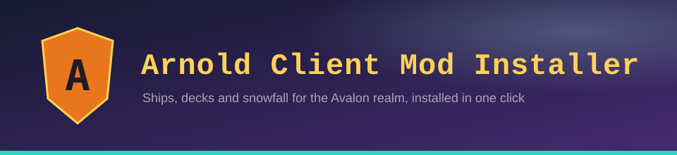

  
  
  
  

---

## ⚔️ What it does

The Arnold Client Mod Installer sets up everything a player needs to see the Avalon realm the way it was built: Arnold's ships with their sails and rigging, decks you can walk on smoothly, and snowfall with drifts and footprints. Pick a kit, press install, and play.

These client mods are **optional**. Players without them can still join the server; they just miss the extra visuals.

## 🛡️ Kits

| Kit | For | What's inside |
|---|---|---|
| **Basic** | Almost any PC | Sodium for smooth FPS, Arnold Decks, Ships and *lighter* Snowfall, Wakes and Particle Rain |
| **Full** | Gaming PCs | Everything in Basic with full Snowfall, plus shaders (Iris + Complementary Reimagined) and the Ocean mods |
| **Custom** | Tinkerers | Pick mods one by one. Arnold Decks always stays on |

Not sure? The installer scans your PC and recommends a kit.

## 📜 Installing

1. Download the latest release for your system from **[Releases](../../releases)**.
2. Close Minecraft, then run the installer.
3. Choose a kit and press **Install**.
4. Open the Minecraft launcher and pick the **Fabric** profile.

<b>Windows says "Windows protected your PC"</b>

The installer isn't code-signed. Click **More info**, then **Run anyway**.

<b>macOS says the app can't be opened</b>

Right-click (or Control-click) the app, choose **Open**, then confirm with **Open**. You only need to do this once.

## 🔒 Safe by design

- Every file is checked against a pinned SHA-512 checksum before it is installed.
- Downloads come only from Modrinth and this repository's releases.
- Your existing `mods` folder is backed up first, and an install can be rolled back.
- The installer only removes files it installed itself. Your own mods are left alone.
- Your own settings are kept when you update.

## 🗺️ Roadmap: 3.0

Installer 3.0 replaces the separate Windows and Mac/Linux scripts with one app for all three systems. It adds one-click rollback, self-updating, Minecraft and Fabric detection, clear error messages and an install log you can share. It is being built here and is not released yet.

## 🔨 Contributing

`main` is protected. Changes come in through pull requests and are merged only after the owner approves them.

---

Made for the Avalon realm · Not affiliated with Mojang or Microsoft

