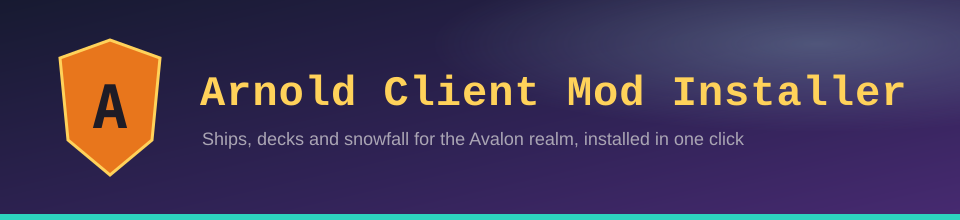

  
  
  
  

---

## ⚔️ What it does

The Arnold Client Mod Installer sets up everything a player needs to see the Avalon realm the way it was built: Arnold's ships with their sails and rigging, and decks you can walk on smoothly. Pick a kit, press install, and play. Better Adventures+ already covers snow.

The Arnold server runs Better Adventures+ 1.64, so every kit installs the Better Adventures+ mods the server needs to let you join. Everything else (shaders, client-only Better Adventures+ extras, the Ocean pack) is optional.

## 🛡️ Kits

| Kit | For | What's inside |
|---|---|---|
| **Basic** | Almost any PC | The Better Adventures+ mods needed to join, Sodium and the client performance mods, Arnold Decks and Ships, Diet+ food groups, Serene Seasons, Drink Beer Refill, Farmer's Delight, Hardcore Revival, Waystones, Cultural Delights, Xaero's maps, Shippy Ships, Traveler's Backpack, feeding troughs, Wakes and Particle Rain |
| **Full** | Gaming PCs | Everything in Basic, plus the Better Adventures+ client mods (including Better Snow Coverage), shaders (Iris + Complementary Reimagined, Miniature), AppleSkin food info and the Ocean mods |
| **Custom** | Tinkerers | Pick mods one by one. Arnold Decks and the mods needed to join always stay on |

Full and Recommended also put the six Better Adventures+ resource packs in your `resourcepacks` folder. Turn them on in Minecraft under Options → Resource Packs. Installer 3.2.0 or newer is needed for this mod list.

Not sure? The installer scans your PC and recommends a kit.

## 📜 Installing

1. Download the latest release for your system from **[Releases](../../releases)**.
2. Close Minecraft, then run the installer.
3. Choose a kit and press **Install**.
4. Open the Minecraft launcher and pick the **Arnold — Better Adventures+** profile. If the installer can see the launcher it offers a button for that and closes itself once the launcher has started. Otherwise it tells you the profile name. Finish closes the installer. By default the pack lives in its own folder under `arnold-packs`, not in the shared Minecraft folder.

<b>Windows says "Windows protected your PC"</b>

The installer isn't code-signed. Click **More info**, then **Run anyway**.

<b>macOS says the app can't be opened</b>

Right-click (or Control-click) the app, choose **Open**, then confirm with **Open**. You only need to do this once.

## 🔒 Safe by design

- Every file is checked against a pinned SHA-512 checksum before it is installed.
- Downloads come only from Modrinth and this repository's releases.
- Your existing `mods` folder is backed up first, and an install can be rolled back.
- The installer only removes files it installed itself. Your own mods are left alone.
- Your own settings are kept when you update.

## 🗺️ Roadmap: 3.0

Installer 3.0 replaces the separate Windows and Mac/Linux scripts with one app for all three systems. It adds one-click rollback, self-updating, Minecraft and Fabric detection, clear error messages and an install log you can share. It is being built here and is not released yet.

## Credits

Pack art: Matcha Flavoured icon by Klei Wright, used unmodified under [CC BY-NC-SA 4.0](https://creativecommons.org/licenses/by-nc-sa/4.0/). [Source on Modrinth](https://modrinth.com/resourcepack/matcha-flavoured).

## 🔨 Contributing

`main` is protected. Changes come in through pull requests and are merged only after the owner approves them.

---

Made for the Avalon realm · Not affiliated with Mojang or Microsoft

